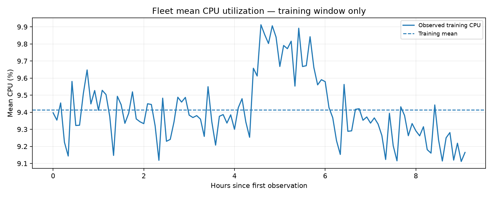
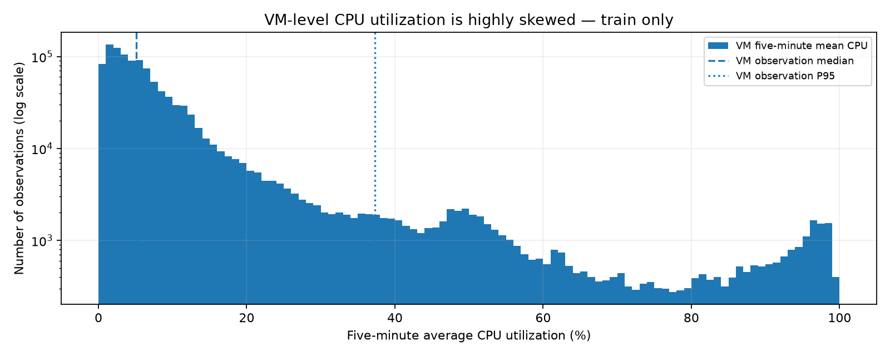
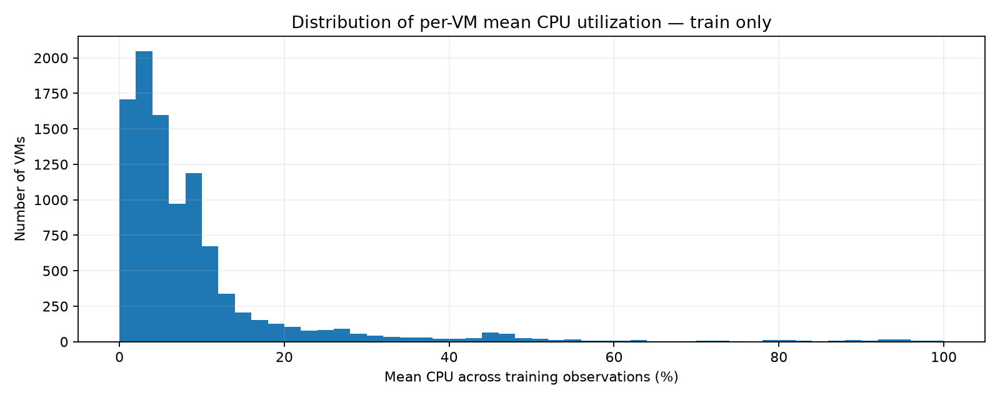
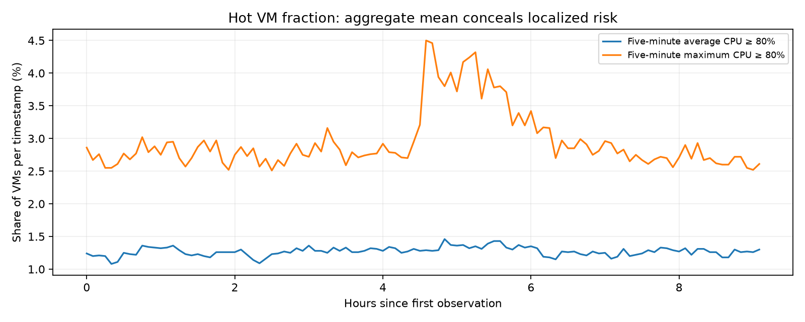
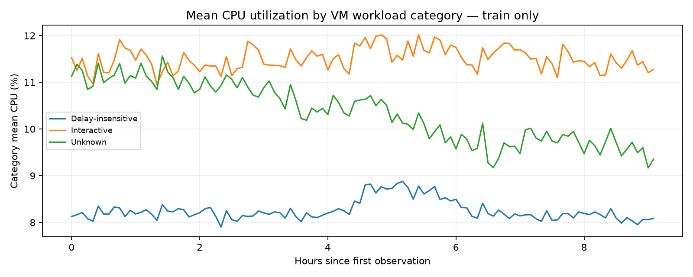

# EDA: Azure cloud workload, training data only

> Reproduce with `python -m cwfc.eda --data challenge_data --output reports`.
> This is an exploration report, **not** the required 4–6 page final modeling report.

## Scope and validation

- Full source file: 1,340,000 CPU observations across 10,000 VMs and 134 timestamps; 10,000 metadata rows.
- **Training-only CPU analysis**: 1,100,000 observations at the first 110 timestamps. The final 24 timestamp *coordinates* are reserved for the forecasting template; their CPU measurements are excluded from all plots, summaries, and feature construction.
- Timestamp increment: 300 seconds. Source timestamps are **relative seconds**, not real dates; avoid fabricated hour-of-day or weekday features.
- Training missing measurements: 0; training duplicate `(timestamp, vm_id)` pairs: 0.
- Per-VM training coverage: 110–110 timestamps. CPU measurements satisfy `[0, 100]` and min ≤ avg ≤ max.

## Aggregate targets

- Active VM count is **10,000–10,000** in the training window (1 unique value). This is explained by the dataset's deliberate selection of complete VM traces, **not evidence of zero churn in Azure generally**.
- Fleet average CPU: **9.4141%**, standard deviation 0.1936 percentage points; range **9.1116%–9.9122%**.
- Peak aggregate CPU in the training window: 9.9122% at relative timestamp 16500 seconds; minimum 9.1116% at 32400 seconds.
- Lag-1 autocorrelation: 0.667. Short-lag persistence may help a statistical baseline, but one ~9-hour training window cannot demonstrate daily/weekly seasonality.

## VM-level heterogeneity and localized demand

- Median VM observation CPU: **5.12%**, while the P95 and P99 are **37.29%** and **87.41%**.
- **48.93%** of VM observations have average CPU below 5%, yet **1.27%** have five-minute average CPU at least 80%.
- **2.95%** of observations have an intra-interval maximum at least 80%. Mean and maximum measure different risks and must not be equated.
- The aggregate mean cannot guarantee low resource pressure for every VM, host, deployment or tenant.

## Workload segments (training readings; static VM categories)

| VM category | VMs | Mean CPU | P90 CPU | Share of readings avg ≥80% |
|---|---:|---:|---:|---:|
| Delay-insensitive | 6,180 | 8.26% | 15.44% | 0.89% |
| Interactive | 3,091 | 11.51% | 28.54% | 1.91% |
| Unknown | 729 | 10.35% | 31.26% | 1.78% |

Core buckets are labels, **not exact provisioned core counts**; using these buckets directly as exact capacity weights would be unjustified.

| Virtual-core bucket | VMs | Mean CPU |
|---|---:|---:|
| 2 | 7,534 | 9.76% |
| 4 | 1,908 | 7.92% |
| 8 | 486 | 9.66% |
| 24 | 62 | 11.43% |
| >24 | 10 | 6.62% |

Memory buckets (labels, not exact allocated GB):

| Memory bucket | VMs | Mean CPU |
|---|---:|---:|
| 2 | 3,904 | 8.80% |
| 32 | 1,383 | 7.81% |
| 4 | 2,475 | 11.46% |
| 64 | 82 | 11.22% |
| 8 | 2,146 | 9.14% |
| >64 | 10 | 6.62% |

Observed training telemetry entries/exits after/before boundary timestamps:
0 /
0. These are telemetry
transitions, not inferred lifecycle events.

## Operational interpretation

1. Use a naive/short-history statistical baseline as the initial forecasting reference: aggregate load is smooth relative to VM-level load, and only 110 training steps are available.
2. Active VM count forecasting can start with persistence, but fixed VM count is a **sampling-design artifact**. The data cannot support a strong churn forecast for a live cloud fleet.
3. Evaluate tail risk independently of the mean: a steady 9% fleet average can coincide with a small but important set of VMs at ≥80% CPU.
4. Any scaling/headroom policy will need a buffer calibrated using **rolling-origin errors**, not a constant margin asserted from this EDA alone.

## Explicit limitations and leakage controls

- Training EDA excludes observed final-holdout CPU values; the unseen holdout target must not drive feature selection, training, or model comparison.
- Metadata fields `avg_cpu`, `max_cpu`, `p95_max_cpu`, and `timestamp_vm_deleted` are intentionally **not used**: they can encode information from beyond the forecast origin.
- VM population is a curated, stratified subset of long-enough complete traces; neither churn nor true fleet-wide rates are representative of all Azure VMs.
- Mean VM utilization is an **unweighted percentage**. It is not total CPU-core demand or a rigorous host capacity measure; virtual-core buckets are not exact core counts.
- The time grid is relative seconds. **No claims of daily/weekly patterns** are defensible from this short window alone.

## Modeling results

See `final_report.md` for matched 24-step expanding-window backtests, model selection, residual diagnostics and operational recommendations.
