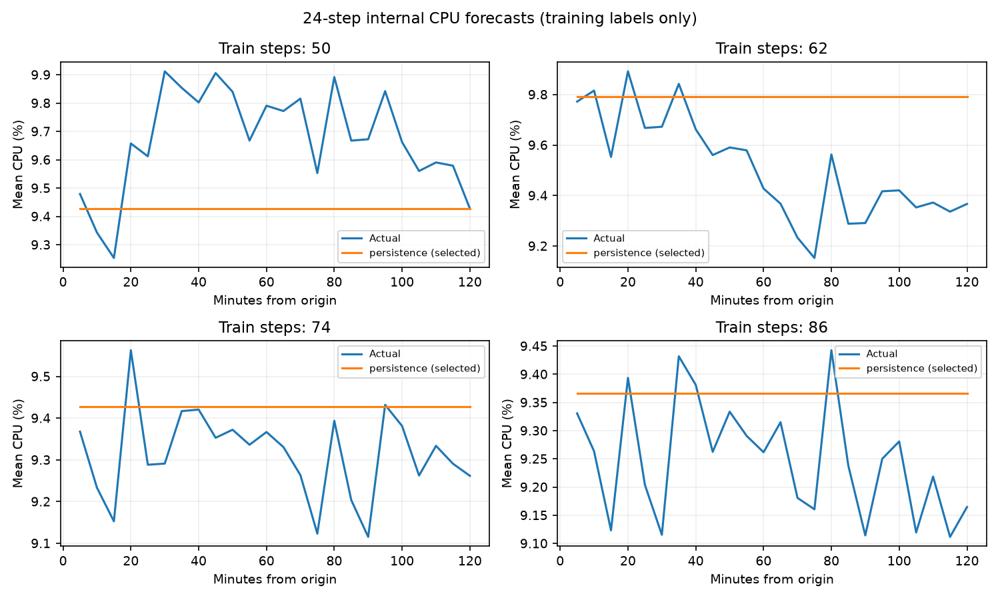
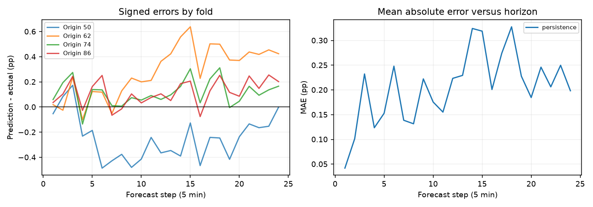

# Cloud workload forecasting: final technical report

Microsoft Azure Public Dataset V2, Atomity curated `data-v1`. All empirical
performance claims below use internal training-window validation. Regenerate
with `python -m cwfc.report --data challenge_data --output reports`.

## 1. Executive summary

The fleet's unweighted CPU mean is low but masks concentrated load. Across
1,100,000 permitted training VM observations, mean fleet
CPU is **9.4141%** and the range is
9.1116%-9.9122%. Meanwhile,
1.27% of VM observations have average
CPU at least 80%. Aggregate capacity and individual VM pressure require
separate monitoring.

Nine compact candidates were compared at four expanding origins. Persistence
is selected separately for both targets: CPU validation MAE is
**0.2056 percentage points (pp)** and RMSE **0.2540 pp**;
active-count MAE and RMSE are zero in this curated, constant-population sample.
Ridge slightly improves CPU RMSE but does not improve MAE. There is insufficient
evidence to justify added complexity under the stated MAE selection rule.

The final two-hour prediction is 9.1646% mean CPU and
10,000 active VMs at every required timestamp,
derived from the last training observations. The observed public holdout
labels have never been scored or used to choose a model. These predictions
support monitoring and cautious planning; they do not establish safe physical
capacity reductions.

## 2. Dataset and preprocessing

The release samples 10,000 complete VM traces, stratified by category and core
bucket using deterministic identifier ranking. There are 134 timestamps at
300-second cadence (1,340,000 rows); the first 110 form training and the last
24 are reserved. Source timestamps are relative trace seconds. No wall-clock,
daily or weekly features are invented. Three SHA-256 manifest entries were
verified. All training observations pass range and min/average/max consistency
checks, with zero missing measurements or duplicate VM/timestamp pairs.

The target constructor counts distinct VM IDs with non-null average CPU and
averages their `avg_cpu` percentages without weighting. Duplicate pairs are
rejected rather than arbitrarily averaged. Missing VM rows or null averages
are excluded from both targets; partial telemetry is not imputed as idle CPU.
An entirely unobserved training timestamp, invalid CPU range/order, or missing
five-minute grid point raises an explicit error. This distinguishes missing
telemetry from actual inactivity. The supplied sample needs no imputation.

The complete target series is constructed and immediately sliced; holdout
labels are discarded inside the loader. Downstream prediction accepts only a
training target frame and future timestamp coordinates. EDA receives only
training readings. Metadata CPU summaries and deletion times are excluded;
static categories and hardware buckets serve descriptive segmentation only.
No model uses VM identities or metadata, and all Ridge centering, lag features,
smoothing states and residual summaries are constructed within the appropriate
training prefix. Synthetic tests change future CPU values and potentially
leaking metadata and verify identical model choices and forecast CSV bytes.

## 3. Workload understanding

Training covers 110 intervals, with first-to-last span 9.083 hours. Every VM
has all 110 observations. There are zero observed telemetry arrivals or
departures within this cohort. Complete-trace selection explains constant
activity; it provides no evidence that real Azure fleets have no churn.
Fleet CPU standard deviation is 0.1936 pp and lag-one
autocorrelation is 0.667. The maximum
training aggregate occurs at relative second 16500,
and the minimum at 32400. The short rising and
falling excursions do not establish repeatable seasonality.

The VM-reading median is 5.12%, P95
37.29% and P99 87.41%. Below-5% readings
account for 48.93%. High five-minute maxima
occur in 2.95% of readings, distinct
from the 1.27% with high averages.
Thus brief bursts and sustained saturation need separate alerts. The maximum
high-average fraction at one timestamp is
1.46%.

| category | vms | mean_cpu | high_cpu_pct |
|---|---|---|---|
| Delay-insensitive | 6180 | 8.2573 | 0.8923 |
| Interactive | 3091 | 11.5051 | 1.9120 |
| Unknown | 729 | 10.3547 | 1.7783 |

CPU columns above are percentages; `high_cpu_pct` is the percentage of segment
readings with average CPU >=80%. Interactive workloads have greater average
and high-tail demand than delay-insensitive workloads, suggesting that
latency-sensitive segments deserve separate protection. The descriptive
category labels' availability should be verified before production use.
Core and memory bucket tables are reproduced in [EDA](eda_summary.md).
Bucket labels are not exact capacity counts; no core-weighted demand is inferred.
Additional distribution and hot-VM figures are in that companion analysis.

## 4. Forecasting approach and validation

Candidates are persistence, full-history mean, trailing means of 6 and 24 steps,
SES with fixed alpha 0.2 and 0.6, damped Holt (alpha 0.2, beta 0.1, phi 0.9),
and recursive Ridge with six lags and penalties 1 and 10. SES starts at the
first observation; Holt starts at that level with zero trend. Ridge centers
its design and response within each fit and penalizes coefficients, not the
intercept. Its target uses the next observation after each six-value window.
All models generate the full horizon without consuming validation actuals;
recursive Ridge appends predictions to its own history. CPU is clipped to
[0,100] and counts to nonnegative values. These are deterministic NumPy
implementations without optimizer or random-seed dependence.

Expanding folds train on indices 0-49, 0-61, 0-73 and 0-85, then predict the
next 24 observations each. Every candidate uses identical folds and no random
split. These provide 96 forecast errors per model but only 60 unique validation
timestamps because origins overlap by 12 steps. This mirrors frequent forecast
refreshes, while correlated folds limit effective sample size and prevent
strong significance claims. Every observation is weighted equally within
pooled MAE. The final 24 public observations are outside all folds.

The explicit selection rule requires more than 5% pooled MAE improvement over
persistence; among candidates within 1% of the minimum MAE, use the first in
predeclared simplicity order. MAE is the primary loss because it measures
average absolute utilization error directly. RMSE, signed bias, peak error
and stability provide additional evidence; selecting by a different loss
could favor Ridge. The 5% gate is an engineering complexity threshold, not a
statistical significance test: a modest gain is required to justify additional
maintenance given only four dependent origins. It was not tuned to holdout
performance. Persistence is the outright MAE minimum here even without the gate.
Fixed small parameter sets reduce search
pressure; validation still informs model selection, so these are development
estimates rather than independent final-test performance.

## 5. Quantitative results

CPU metrics are in percentage points. Relative MAE divides by persistence
MAE; negative improvement means a worse result.

| model | mae | rmse | relative_mae | improvement_pct |
|---|---|---|---|---|
| persistence | 0.2056 | 0.2540 | 1.0000 | 0.0000 |
| mean | 0.2141 | 0.2497 | 1.0413 | -4.1339 |
| moving_average_6 | 0.2659 | 0.3077 | 1.2933 | -29.3300 |
| moving_average_24 | 0.2780 | 0.3096 | 1.3518 | -35.1831 |
| ses_0.2 | 0.2521 | 0.2907 | 1.2259 | -22.5853 |
| ses_0.6 | 0.2237 | 0.2671 | 1.0879 | -8.7885 |
| holt_damped | 0.2563 | 0.3149 | 1.2467 | -24.6699 |
| ridge_6_1 | 0.2062 | 0.2414 | 1.0029 | -0.2865 |
| ridge_6_10 | 0.2141 | 0.2477 | 1.0412 | -4.1217 |

All active-count candidates have MAE/RMSE zero on these folds. Their relative
MAE and percentage improvement are **undefined** because baseline error is
zero. Persistence is the simplest tie winner, using the observed count rather
than a hard-coded VM population. High-load count observations are absent, so
count peak-error metrics are also undefined.

Selected CPU model by origin (number of available training steps):

| origin | mae | rmse | bias |
|---|---|---|---|
| 50 | 0.2681 | 0.3028 | -0.2467 |
| 62 | 0.2975 | 0.3457 | 0.2827 |
| 74 | 0.1245 | 0.1522 | 0.1128 |
| 86 | 0.1324 | 0.1542 | 0.1172 |

Persistence's fold MAE standard deviation is 0.0779 pp and
its worst-fold MAE is 0.2975 pp. Fold-dependent bias changes
sign: an origin before an upward excursion underpredicts, while a relatively
high origin followed by lower load overpredicts. A flat forecast cannot
anticipate either event. Smoothing delays response to such shifts; recursive
Ridge regresses toward its estimated local equilibrium and can miss peaks.

## 6. Failure analysis and uncertainty

Signed error is prediction minus actual. Pooled selected-model bias is
+0.0665 pp. High load means actual CPU exceeds the **fold training**
90th percentile, with the threshold fixed before that forecast. Across
26 such forecast instances, MAE is
0.2524 pp, larger than overall MAE. Overlap means these
instances are not independent extreme events. Per-step errors and every
candidate's per-fold metrics are available in the CSV appendices.

| steps | mae | bias |
|---|---|---|
| 1-6 | 0.1500 | 0.0464 |
| 7-12 | 0.1745 | -0.0284 |
| 13-18 | 0.2792 | 0.1216 |
| 19-24 | 0.2188 | 0.1265 |

Grouped horizon metrics above use equal numbers of forecast instances per
step. Performance does not have to deteriorate monotonically: the realized
shape of these few validation trajectories matters more than nominal horizon.

The pooled 90th percentile of absolute selected CPU residuals is
0.4276 pp. Adding/subtracting this fixed radius gives an exploratory
sensitivity band of 8.7369%-
9.5922% for the final point forecast.
`forecast_uncertainty.csv` stores these bounds separately from submission
predictions. A chronological diagnostic calibrates using earlier folds whose
labels have already arrived at each subsequent origin; its descriptive
coverage is 94.44% over 72 forecast instances. That is not proof
of nominal coverage: errors overlap, only four origins exist, model selection
used all folds, and future regimes may differ. The bounds pool horizons and
do not model horizon-dependent risk. A zero active-count residual band
reflects sample design and must not imply zero future fleet uncertainty.

## 7. Capacity recommendation

Use the point forecast as a near-term aggregate monitoring reference. Keep
existing operational headroom until placement, true core demand, memory,
latency and scaling costs are known. As an illustrative warning trigger,
compare observed fleet CPU with forecast plus the 0.4276 pp historical
error radius, and investigate persistent exceedances rather than automatically
adding hosts. This margin is a utilization discrepancy buffer, not a measured
number of spare cores. A breach may indicate drift or changed telemetry.

At the same time, monitor per-VM average and maximum CPU, hot-VM fraction,
queue depth and latency separately. Repeated average CPU >=80% is an
illustrative investigation threshold, not a validated service-level limit.
Prioritize interactive workloads and deployment/tenant hotspots; defer
flexible batch work when segment pressure and latency rise together.
Do not consolidate hosts simply because the unweighted fleet mean is low.
Under-provisioning risks queue buildup and missed SLOs; over-provisioning buys
headroom at recurring cost. Production actions should include cooldowns,
hysteresis, minimum capacity and rollback, with thresholds established from
costs and service behavior rather than this short curated trace.

## 8. Limitations and next work

This sample excludes incomplete traces and is stratified rather than a random
fleet snapshot. It cannot validate real churn, rare failures or fleet-wide
rates. Roughly nine hours of training cannot identify daily/weekly cycles,
regime changes or reliable tail probabilities. Static classification may be
retrospective; future lifecycle timestamps and whole-trace summaries are
particularly unsafe. Missing telemetry can reduce an apparent active count
without a VM actually stopping.

A production policy needs longer representative history, exact vCPU/memory
allocations, VM-host placement and oversubscription, deployment/tenant context,
actual lifecycle events, demand and latency SLOs, request queues, scaling lead
times, allocation constraints, cost and incident labels. Collect these before
claiming savings or calibrated uncertainty. With more history, reserve a
separate chronological test period, compare segment forecasts, use nested
model selection and evaluate interval coverage across regimes. The honest
conclusion here is that persistence is a strong, reproducible baseline under
the chosen loss; generalization beyond this window remains unmeasured.

## Reproduction and evidence appendix

- `eda_stats.json`, `eda_summary.md`: training-only statistics and hardware buckets.
- `model_comparison.csv`: all targets, MAE/RMSE, bias, high-load error and fold stability.
- `backtest_predictions.csv`: every internal actual, forecast, origin and horizon.
- `fold_metrics.csv`, `horizon_metrics.csv`: detailed failure analysis.
- `selection.json`: model choices, rule, folds and uncertainty diagnostics.
- `forecast_uncertainty.csv`: final exploratory bounds without holdout labels.
- `audit.md`: initial audit, validation commands and implementation changes.

All report values are generated from these artifacts by `cwfc.report`. The
submission CSV is independently regenerated by `cwfc.predict`; no manual
prediction editing or public holdout scoring is performed.
